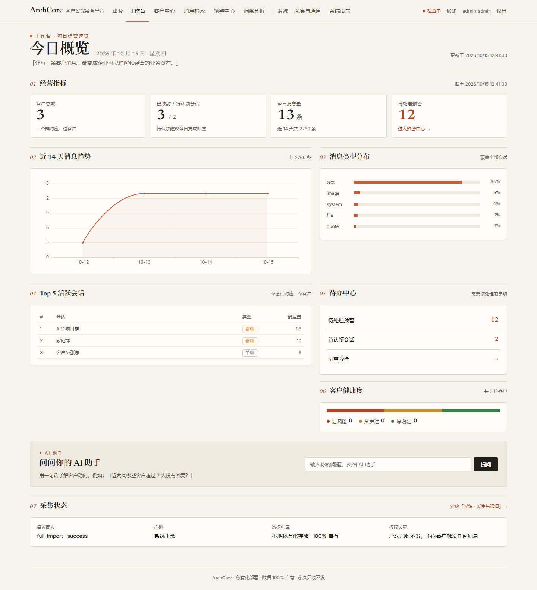
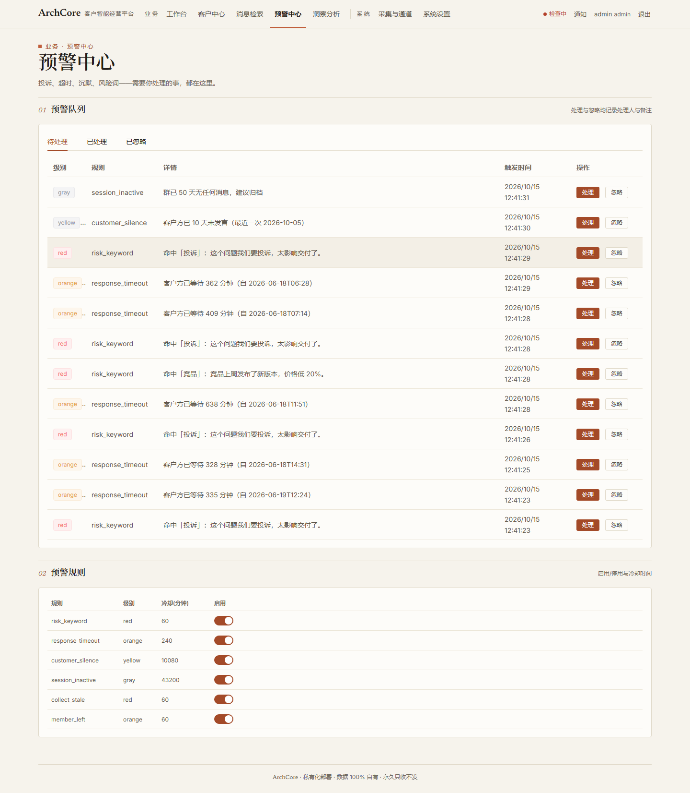
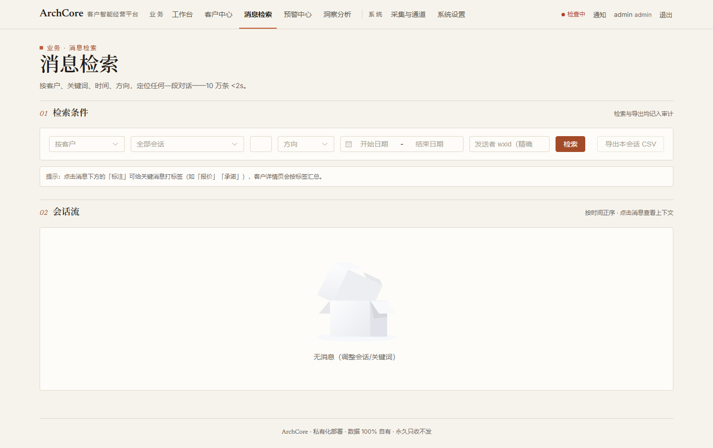
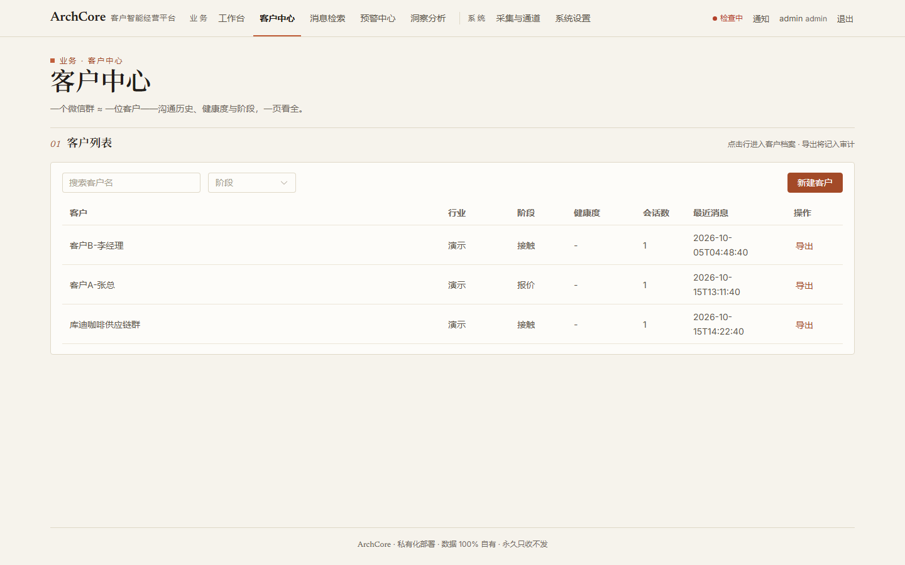
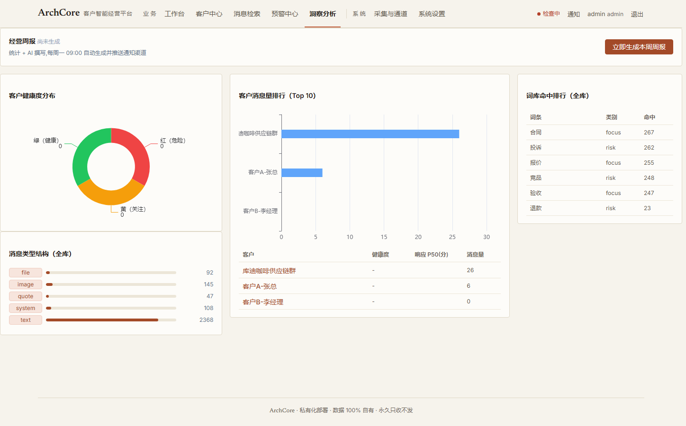

<div align="center">

# ArchCore

**微信客户智能经营平台 · 私有化 SCRM 高阶形态**

_归档 · 检索 · 画像 · 预警 · 分析 · AI_

**让每一条客户消息，都变成企业可以理解和经营的业务资产。**

[](https://gitee.com/bty1987/ArchCore/stargazers)
[](https://gitee.com/bty1987/ArchCore/fork)


</div>

---

## 这是什么

ArchCore 是一套**跑在你自己电脑/内网**的微信客户智能经营系统。它以"会话资产化"为底座，向上生长出一整套经营能力：**秒级检索 → 客户画像 → 智能预警 → 经营分析 → AI 摘要**——围绕 **"一个微信群 ≈ 一个客户"** 的核心模型，把散落在微信里的客户沟通，变成可检索、可理解、可预警、可分析的企业资产。

**它解决的真实痛点：**

- 客户在微信群里说了需求，三天后没人找得到那条消息——**归档+检索**解决；
- 客户的意向、偏好、活跃度散落在聊天记录里，没人看得全——**画像**解决；
- 员工漏回客户消息、投诉和竞品动向无人察觉——**预警**解决；
- 老板问"这个客户聊到哪了、团队跟得怎么样"，答案靠回忆——**分析**解决。

**数据边界（卖点，也是底线）**：系统部署在你自己的电脑/内网，数据全程不离开你的服务器；系统**永久只收不发**——不做任何群发、加好友类操作，卖的是理解、沉淀、分析、提醒，不是替你自动聊。

## 能力全景

```text
┌──────────────────────────────────────────────────────┐
│  经营分析    消息趋势 · 响应时长 · 成员/客户活跃排行        │
├──────────────────────────────────────────────────────┤
│  AI 摘要    会话智能摘要 · 自动标签                     │
├──────────────────────────────────────────────────────┤
│  智能预警    响应超时 · 投诉 · 报价 · 竞品 → 实时推送     │
├──────────────────────────────────────────────────────┤
│  客户画像    群 ≈ 客户建档 · 标签体系 · 活跃度 · 历史一页看全│
├──────────────────────────────────────────────────────┤
│  秒级检索    客户 / 关键词 / 时间 / 发送者，10 万条 <2s   │
├──────────────────────────────────────────────────────┤
│  会话资产化  历史全量 + 增量自动同步 · 富内容解析          │
└──────────────────────────────────────────────────────┘
        底座：私有化部署 · 数据不出内网 · 永久只收不发
```

| 能力板块 | 说明 | 状态 |
|---|---|---|
| 🗄️ 会话资产化（归档） | 历史消息全量导入 + WAL 监听/定时任务双自动增量同步、断点续传；图片/引用/合并转发等富内容解析 | ✅ 已上线 |
| 🔍 秒级检索 | SQLite FTS5 全文检索：按客户、关键词、时间、发送者定位任何一段对话（10 万条 <2s） | ✅ 已上线 |
| 👤 客户画像 | 微信群自动映射客户档案、标签体系、成员/客户活跃度，沟通历史一页看全 | ✅ 已上线 |
| 🚨 智能预警 | 响应超时、投诉、报价、竞品提及、客户沉默等规则引擎 → 实时推送企业微信等通知渠道，处理闭环留痕 | ✅ 已上线 |
| 📊 经营分析 | 消息量趋势、响应时长、成员活跃，ECharts 可视化 | ✅ 已上线 |
| 🤖 AI 摘要 | 会话 AI 摘要与自动标签 | ✅ 已上线 |
| 📝 AI 经营周报 | 统计快照 + AI 撰写一页周报，每周一自动生成并推送通知渠道 | ✅ 已上线 |
| 💬 AI 助手 | 自然语言查数据：「客户问报价了吗」→ 基于归档数据的答案与相关消息引用 | ✅ 已上线 |
| 📈 管道仪表 | 采集成功率、同步耗时、最近成败与每日消息量自检可视化 | ✅ 已上线 |
| ⚡ 实时增强 | WAL 监听器分钟级增量同步（自研，常驻运行） | ✅ 已上线 |

> **规划中（不作为当期承诺）**：客户意向提取 · 智能跟进助手 · 语音转文字。

## 系统预览

> 以下截图为[演示模式](#快速开始开发演示)（合成数据）下的真实运行界面。管理台采用「暖纸账本」设计：衬线排印 + 分节版式 + 单一赭橙主题色。

**工作台 · 今日概览**——10 秒看清生意状态：经营指标、消息趋势、Top 会话、待办、健康度、AI 助手入口：



**预警中心**——投诉/超时/沉默/风险词四类预警，处理闭环留痕，规则可启停调冷却：



**消息检索**——按客户、关键词、时间、方向定位任何一段对话（10 万条 <2s），支持消息标注与会话导出：



**客户中心与洞察分析**——一个微信群 ≈ 一位客户；健康度分布、客户排行、词库命中与 AI 经营周报：

| 客户中心 | 洞察分析 |
|---|---|
|  |  |

## 与主流 SCRM 的区别

如果说主流 SCRM 解决的是"客户怎么加进来、怎么标准化运营"，ArchCore 解决的是更往后、也最容易流失的两件事：**客户资产沉淀**与**经营洞察**。

| 维度 | 主流 SaaS SCRM | ArchCore |
|---|---|---|
| 部署形态 | 厂商云端 SaaS | **私有化**：跑在你自己的电脑/内网 |
| 数据归属 | 存在厂商服务器 | **100% 自有**：SQLite 单文件库，备份即拷贝文件 |
| 微信生态 | 以企业微信为主 | **个人微信**的业务群与客户单聊 |
| 能力重心 | 加客、群发、SOP 自动运营 | 归档 → 检索 → 画像 → 预警 → 分析的全链路洞察 |
| 外发行为 | 群发、自动化触达 | **永久只收不发**，零打扰 |
| 商业模式 | 按人头年费订阅 | 按套私有化交付 + 年服务费（备份/换号/版本维护全含） |

> 与企业微信官方会话存档也不冲突：企微沟通走官方存档，个人微信的业务群与客户单聊归 ArchCore 管。

## 系统架构

```text
微信客户端 (4.x)
 │ 本地数据库（历史全量 + WAL 实时增量，被动读取不干扰微信运行）
 ▼
collector 采集端 ─── 白名单过滤 · 解密适配 · 批量上报 / 断点续传
 │ HTTP 上报
 ▼
server 服务端（FastAPI + SQLAlchemy + SQLite WAL/FTS5 + APScheduler）
 ├─ 归档入库（alembic 迁移管理）
 ├─ 群 → 客户映射 / 客户档案 / 标签
 ├─ 预警引擎 + 通知渠道
 └─ 定时任务（增量同步、心跳报告）
 │
 ├──▶ web 管理台（Vue3 + Element Plus + ECharts）
 └──▶ 通知推送（企业微信等）
```

采集路线：**主轨 = 本地数据库被动读取**（历史全量 + WAL 监听分钟级增量 + 定时任务兜底，已实机验证；被动读盘，不注入、不修改微信进程）。

## 技术栈

| 层 | 技术 | 说明 |
|---|---|---|
| 服务端 | Python 3.10+ · FastAPI · SQLAlchemy 2 · Alembic · APScheduler · PyJWT | REST API、认证、定时任务 |
| 存储 | SQLite（WAL + FTS5） | 单文件内网存储，备份即拷贝文件 |
| 采集端 | Python（fixture / 自研 4.x 解密适配） | 白名单过滤、批量上报、断点续传 |
| 前端 | Vue 3 · Element Plus · ECharts · Vite | 内网管理台（暖纸账本主题，衬线排印 + 分节版式） |
| 质量 | pytest · ruff | server 50 + collector 23 全绿，ruff 0 告警 |

## 快速开始（开发/演示）

**一条命令体验（演示模式，合成数据，与真实数据完全隔离）：**

```bat
install.bat        # 一键安装：venv + 依赖 + 配置生成 + 数据库迁移 + 管理台构建
run-demo.bat       # 演示模式：120 天合成数据 + 预警场景，自动打开管理台（admin / demo-arch-2026）
```

**手动流程（开发）：**

```bat
python -m venv .venv && .venv\Scripts\pip install -e server -e collector
python scripts\gen-fixtures.py            # 生成脱敏合成数据（红线：真实数据不入仓库）
cd server && ..\.venv\Scripts\python -m uvicorn archcore_server.main:app --port 8000
cd web && npm install && npm run dev      # 管理台 http://127.0.0.1:5173
python scripts\perf_check.py              # 性能验收：10 万条检索 <2s
```

> 登录账号：未设置 `ARCHCORE_ADMIN_BOOTSTRAP_PASSWORD` 时为 admin / admin123456；设置了该环境变量（或用 install.bat / start-server.bat 安装启动）则以设置的值为准。**使用默认密码登录会强制要求修改密码**后方可进入系统。

正式部署（个人单机形态：fixture 跑通 → 4.x 解密归档 → 建档分析 → 备份排查）见[本机部署实操指南](docs/local-deploy-guide.md)；测试与质量门禁见 [docs/test-plan.md](docs/test-plan.md)。

## 目录结构

```text
ArchCore/
├── docs/       # 产品与调研文档（见下方索引）
├── server/     # 平台服务端：FastAPI + SQLAlchemy + SQLite(WAL+FTS5) + alembic + APScheduler
├── collector/  # 采集端：解密适配（fixture / 自研 4.x 解密轨）+ 白名单过滤 + 批量上报/断点续传
├── web/        # 管理台前端：Vue3 + Element Plus + ECharts（vite build → dist/）
├── deploy/     # 部署：单机手册 / 一键备份 / systemd 单元 / 交付工具箱
├── design-redesign/  # 管理台设计档案（三方向概念稿/spec/方向选定记录）
├── install.bat / run-demo.bat  # 一键安装 / 演示模式
└── scripts/    # 解密与增量同步 · 合成数据生成 · 性能验证 · 心跳报告
```

## 文档索引

| 文档 | 说明 |
|---|---|
| [docs/wechat-local-access-survey.md](docs/wechat-local-access-survey.md) | 技术调研报告 v1.1（接入路线、同类工具全景、风险评估、9 项 P0 验证清单） |
| [docs/wechat-archive-prd.md](docs/wechat-archive-prd.md) | PRD v0.2（功能需求、预警规则、版本规划、验收标准） |
| [docs/system-design.md](docs/system-design.md) | 系统设计文档 v0.2（总体架构、技术选型、数据模型、关键流程、设计决策记录） |
| [docs/development-plan.md](docs/development-plan.md) | 代码工程规划 v0.2（仓库结构、工程规范、迭代任务拆解 M0/MVP/V1、测试策略） |
| [docs/ops-promotion-plan.md](docs/ops-promotion-plan.md) | 运维与推广规划 v0.2（监控/备份/版本冻结/Runbook/账号资产、三阶段推广路径/定价/交付流程） |
| [docs/outbound-push-plan.md](docs/outbound-push-plan.md) | 主动推送消息方案 v0.2（默认永久只收不发；外发风险分级、工单管道与熔断的实施预案） |
| [docs/compliance-plan.md](docs/compliance-plan.md) | 合规方案 v0.1（第三方个人信息告知、数据最小化、权限收敛、合同责任划分） |
| [docs/test-plan.md](docs/test-plan.md) | 测试方案 v1.0（八层测试体系、46 个自动化用例清单、性能与冒烟、M0 真机验证项） |
| [docs/local-deploy-guide.md](docs/local-deploy-guide.md) | 本机部署实操指南 v1.1（个人单机形态：fixture 跑通 → 4.x 解密归档 → 建档分析 → 备份排查） |
| [docs/retrospective-20260926.md](docs/retrospective-20260926.md) | 实战复盘与决策档案 v1.0（4.x 攻关时间线/决策档案/踩坑清单/生态地图/试错成本/方法论） |
| [docs/customer-os/](docs/customer-os/) | Customer OS 产品方案五件套（竞品拆解/定位/PRD/架构/90天路线，2026-09 方向研究） |
| [docs/customer-os-analysis.md](docs/customer-os-analysis.md) | Customer OS 衔接分析 v1.0（与 ArchCore 对比/领域模型映射/三条融合路径/决策点） |
| [docs/productization-gap-analysis.md](docs/productization-gap-analysis.md) | 产品化差距分析 v1.1（四层差距盘点：交付力/支撑体系/合规/售前材料，P0 清单现状标注与 6~8 周节奏） |
| [docs/product-scenarios.md](docs/product-scenarios.md) | 应用场景与商业定位分析（愿景素材，见文首交付边界说明） |
| [deploy/交付工具箱/](deploy/交付工具箱/) | 交付工程化：客户交付档案模板（版本冻结登记/账号台账/上线检查/验收签字）+ 媒体本体归档攻关任务卡（2026-10-01） |
| [docs/合规文件包/](docs/合规文件包/) | 入群告知与员工知情话术模板 + 合同条款模板（角色/数据归属/账号风险/版本冻结/责任上限；待法务复核） |
| [docs/售前工具箱/](docs/售前工具箱/) | 一页纸介绍 / 15 分钟演示脚本 / FAQ 与预期管理红线 / 定价表（内部勿外发）（2026-10-01） |
| [docs/自媒体推广作战包.md](docs/自媒体推广作战包.md) | 内容线推广 v1.0：3+1 账号矩阵 / 公开内容五红线 / 首批 10 篇选题 / 私域漏斗 / 60 天可证伪门槛（口碑线并行） |

## 里程碑

- **M0 技术验证**：✅ 2026-09-25~26 实机完成（路线定型：冻结 4.1.8.67、自研 4.x 解密 17 库零异常；3.9 路线终结）——见复盘档案
- **MVP**：✅ 已交付——历史导入、群→客户映射、会话浏览器、活跃度分析、预警引擎、通知渠道、AI 摘要、管理台
- **产品化**：✅ 2026-10-15——一键安装（install.bat）、演示模式（run-demo.bat）、首启强制改密、AI 经营周报、AI 助手、管道仪表；管理台「暖纸账本」全新 UI；当前=阶段 0 内部试点（真实业务连用 1 个月）与首批种子客户接触

## 常见问题（FAQ）

**Q：数据会上传到云端吗？**
不会。归档数据全部存放在你自己服务器/电脑上的 SQLite 单文件库中，系统只收不发，备份即拷贝文件（见[一键备份脚本](deploy/backup.py)）。

**Q：支持哪些微信版本？**
当前技术路线冻结在 **微信 4.1.8.67**（自研 4.x 本地库读取适配）；3.9 路线已于 2026-09 终结。微信版本升级可能导致路线失效，版本冻结与恢复 SOP 见[复盘档案](docs/retrospective-20260926.md)。

**Q：和企业微信官方会话存档 / SaaS SCRM 比有什么不同？**
企微官方存档只覆盖企业微信、按人头年费、功能偏大厂；SaaS SCRM 的数据存在厂商云端。ArchCore 面向**个人微信**的业务群与客户单聊，**私有化部署、数据 100% 自有**，按套交付。两者不冲突：企微沟通走官方存档，个人微信归 ArchCore 管。

**Q：商用交付前需要做哪些合规动作？**
归档涉及客户方成员（第三方个人信息主体）的会话数据，正式商用前须完成[合规方案](docs/compliance-plan.md)所列评估项：入群/员工告知话术、合同责任条款、数据最小化与权限收敛等（模板见[合规文件包](docs/合规文件包/)）。

**Q：想在采购前先看看产品？**
运行 `run-demo.bat` 进入演示模式：全部为合成数据（虚构客户、120 天消息、预置预警场景），与任何真实数据完全隔离，安装目录 `data/demo/` 可随时整目录删除。

**Q：默认密码安全吗？**
使用默认密码（bootstrap 密码或历史默认值）登录会被**强制要求修改密码**后才能进入系统；install.bat 安装时自动生成随机 bootstrap 密码与管理端/采集端通信密钥。

## 风险提示与使用边界

本项目采用的微信接入方案为本地数据库被动读取，但仍属非官方接入，存在违反微信用户协议与**封号风险**（详见[调研报告](docs/wechat-local-access-survey.md)），仅限内部客户管理用途；归档涉及客户方成员（第三方个人信息主体）的会话数据，正式商用前须完成[合规方案](docs/compliance-plan.md)所列评估项。

请勿将本项目用于批量营销群发、自动加好友、爬取他人会话数据等任何"主动外发"类场景。

## 许可证

本项目暂未附带开源许可证，**默认保留所有权利（All Rights Reserved）**。当前面向内部试点与授权交付；如需评估、试用或二次集成，请先与作者取得联系。
